<h1 align="center">Stefano Wetzell Ciccia</h1>

  <b>Desarrollador Backend Java · Spring Boot · SQL Server</b> 
  Lima, Perú · <a href="https://www.linkedin.com/in/stefano-wetzell-ciccia-314a591a1">LinkedIn</a> · <a href="mailto:stefanowetzell@gmail.com">stefanowetzell@gmail.com</a>

---

### Sobre mí

Desarrollo backends en Java para procesos reales de negocio. Lidero técnicamente un sistema de gestión empresarial en producción: tomo los requerimientos con las áreas, defino la arquitectura, desarrollo el backend y apruebo cada pase a producción.

- Diseño reglas de negocio: flujos de aprobación, líneas de crédito, márgenes y conciliaciones bancarias y tributarias.
- Integro sistemas con APIs externas (SUNAT, OAuth 2.0) y con la base de datos de un ERP.
- Trabajo SQL Server a fondo: stored procedures, triggers, transacciones y diagnóstico de deadlocks.
- Me adapto rápido a cada dominio: ventas, créditos, logística, importaciones, contabilidad y gerencia.

### Stack

  
  
  
  
  
  
  
  
  
  
  
  
  
  
  
  

### Estadísticas

  
  

Mi trabajo principal está en repositorios privados: las estadísticas incluyen esas contribuciones sin exponer el código.

### Ahora mismo

- Aprendiendo Docker, CI/CD con GitHub Actions y Spring WebFlux.
- Estudiando DDD, arquitectura hexagonal y *Designing Data-Intensive Applications*.
- Cursando Ingeniería de Sistemas y Empresarial en la USIL.
